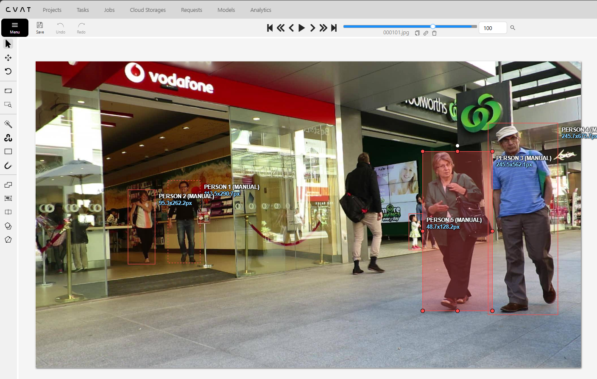
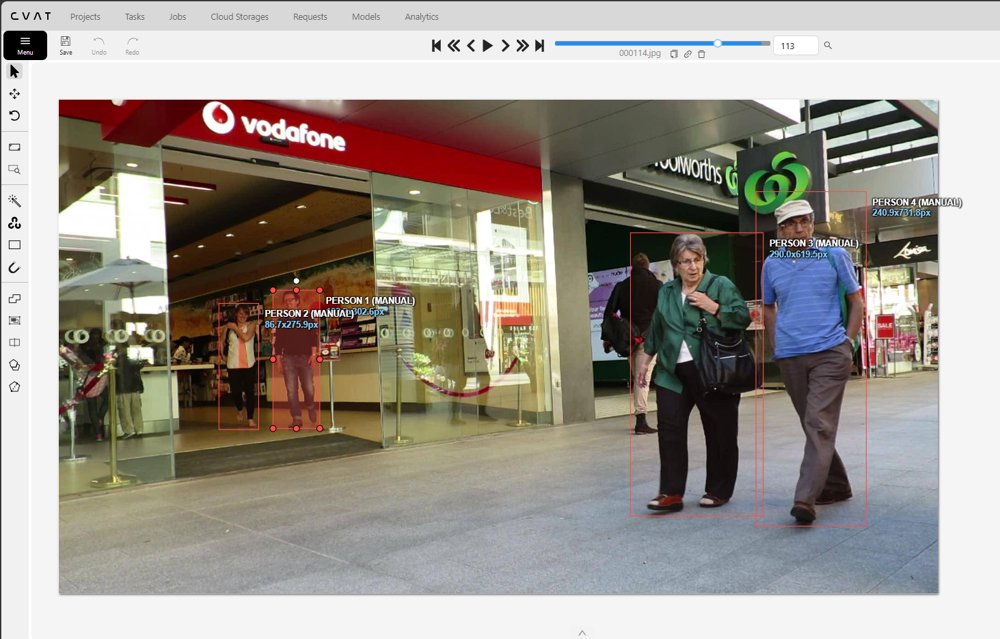
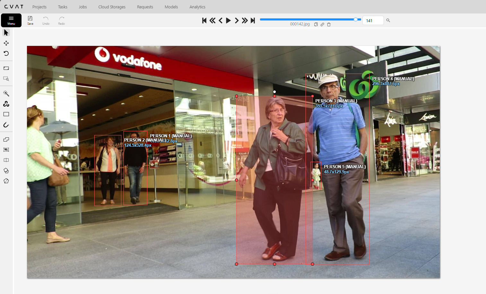

# Báo cáo cá nhân — CuVietDuc-2A202603042

> BẢN CẬP NHẬT CÓ SỐ LIỆU TỰ KIỂM — CHƯA ĐỦ ĐIỀU KIỆN NỘP HOÀN CHỈNH. Còn hai cảnh báo cần kiểm tra; thiếu ảnh CP2 của P1 và xác nhận tự review, kết luận, trạng thái job. Không có dữ liệu thì không tự nhận đã thực hiện.

Đoạn video: MOT17-09, 150 frame, 1920×1080, 30 fps. Frame trong báo cáo đếm theo CVAT: 0–149; frame trong MOT = frame CVAT + 1.

## 0. Thông tin học viên

- Họ tên: Cù Việt Đức
- MSSV: 2A202603042
- Mã đề: A
- Email: Chưa được học viên xác nhận.
- Link repository: https://github.com/CuDuc2211/K5-L2-DAY05-CUVIETDUC-2A202603042-MOTTracking
- Task: DAY05-MOT17-09-A-2A202603042 (task 16; segment/job 12 trong metadata).
- Giờ bắt đầu: 16:30 ngày 13/11/2026 (GMT+7), theo học viên cung cấp.
- Giờ kết thúc: 18:30 ngày 13/11/2026 (GMT+7), theo học viên cung cấp.
- Tổng thời gian buổi làm bài: 120 phút. Chưa có thời gian riêng từng người; không chia đều để thay số liệu thực tế.

### Đối chiếu định danh

Mã P1–P5 được đối chiếu với vị trí tham chiếu đề A và các box xuất ra. ID XML và ID MOT khác nhau do xuất/chuyển thứ tự track; riêng sự khác nhau về số ID không phải bằng chứng ID switch.

| Mã người | ID trong XML | ID trong MOT | Nhận diện ở các ảnh được cung cấp |
|---|---:|---:|---|
| P1 | 0 | 1 | Người nam áo tối, quần jeans, phía cửa hàng bên trái |
| P2 | 1 | 5 | Người nữ áo sáng, quần tối, phía cửa hàng bên trái |
| P3 | 2 | 2 | Người nữ áo xanh đậm, đeo túi, phía trước bên phải |
| P4 | 3 | 4 | Người nam áo xanh dương, đội mũ sáng |
| P5 | 4 | 3 | Trẻ nhỏ mặc đồ sáng ở phía sau, gần cửa hàng bên phải |

## 1. Xem trước đoạn video (CP0)

Chưa nhận bảng ghi trước khi vẽ. Các mốc dưới đây được trích sau khi hoàn thành từ annotation, không được xem là bằng chứng đã xem trước. Thời điểm xuất hiện và cờ là kết quả đã gán, chưa đối chiếu ground truth.

| Mã | Frame đầu có box | Frame cuối có box | Rẽ / dừng / đổi tốc độ | Frame được gán occluded | Ghi chú |
|---|---:|---:|---|---|---|
| P1 | 0 | 149 | Chưa có ghi chép thực tế | 0–38, 49–54, 57, 98–111 | Các mốc trích từ file xuất |
| P2 | 42 | 149 | Chưa có ghi chép thực tế | 42–98 | Các mốc trích từ file xuất |
| P3 | 0 | 149 | Chưa có ghi chép thực tế | Không | Các mốc trích từ file xuất |
| P4 | 17 | 149 | Chưa có ghi chép thực tế | 17–62 | Các mốc trích từ file xuất |
| P5 | 0 | 146 | Chưa có ghi chép thực tế | 105–109, 135–140, 142–146 | Các mốc trích từ file xuất |

## 2. Keyframe và thời gian (CP1, CP4)

Số keyframe tính theo script chính thức: chỉ tính keyframe có outside=0. Các mốc bật outside vẫn có thể là keyframe trong XML nhưng không cộng vào số bên dưới.

| Mã | Số keyframe | Keyframe ở frame | Số frame có mặt | Keyframe / 100 frame | Thời gian (phút) | Chỗ cần xem lại |
|---|---:|---|---:|---:|---|---|
| P1 | 75 | 0, 1, 10, 17, 19, 20, 21, 22, 23, 24, 25, 26, 27, 28, 29, 30, 31, 32, 33, 34, 35, 36, 37, 38, 49, 51, 52, 54, 55, 56, 57, 58, 59, 60, 61, 68, 69, 73, 75, 76, 77, 78, 79, 83, 84, 85, 86, 87, 88, 89, 95, 96, 97, 98, 99, 104, 105, 109, 110, 111, 112, 113, 114, 115, 116, 117, 118, 119, 122, 125, 126, 129, 139, 144, 149 | 140 | 53.6 | Chưa ghi riêng | 75 keyframe; mật độ vượt 50/100 frame |
| P2 | 47 | 42, 44, 45, 46, 47, 48, 49, 50, 56, 57, 58, 59, 60, 61, 62, 63, 67, 68, 69, 73, 77, 78, 81, 83, 84, 85, 86, 87, 89, 92, 93, 98, 99, 100, 101, 102, 103, 109, 113, 123, 130, 133, 139, 141, 142, 143, 149 | 108 | 43.5 | Chưa ghi riêng | Chiều cao box thay đổi >30% tại frame 63 |
| P3 | 48 | 0, 9, 10, 16, 20, 25, 27, 28, 30, 38, 40, 45, 50, 56, 57, 60, 64, 70, 73, 77, 78, 80, 85, 87, 90, 92, 100, 106, 108, 109, 110, 117, 119, 120, 123, 124, 125, 126, 127, 128, 130, 133, 136, 137, 139, 140, 145, 149 | 150 | 32.0 | Chưa ghi riêng | Chưa có nhận xét riêng của học viên |
| P4 | 41 | 17, 19, 20, 24, 26, 30, 34, 39, 40, 47, 50, 58, 59, 60, 61, 62, 63, 64, 65, 66, 67, 68, 69, 70, 80, 90, 93, 100, 110, 116, 120, 129, 130, 134, 138, 139, 140, 144, 145, 148, 149 | 133 | 30.8 | Chưa ghi riêng | Được gán occluded 17–62; cần tự xác nhận đúng đoạn |
| P5 | 23 | 0, 10, 18, 20, 26, 30, 40, 50, 70, 105, 106, 107, 108, 109, 135, 139, 140, 141, 142, 143, 144, 145, 146 | 122 | 18.9 | Chưa ghi riêng | Outside 110–134 và từ 147 đến hết đoạn; cần tự xác nhận |
| **Tổng** | **234** | — | **653** | **35,8** | **120 phút cho toàn buổi, gồm các công việc khác** | **2 cảnh báo tự kiểm** |

Keyframe / 100 frame của cả bài = 234 ÷ 653 × 100 = **35,8**.

P1 có nhiều keyframe nhất (75). Chưa có lời giải thích từ học viên về nguyên nhân đặt dày; số liệu không tự chứng minh nguyên nhân là rẽ, dừng hay bị che. Cần xem lại để loại bỏ keyframe dư nếu phù hợp, giữ chất lượng nội suy, rồi xuất và chạy kiểm tra lại.

## 3. Đoạn bị che (CP2)

Người bắt buộc theo checkpoint: **P1** (XML 0, MOT 1).

| Mốc | Frame theo file xuất |
|---|---:|
| Bắt đầu đoạn occluded trước lần mất hẳn | 0; đã được đánh dấu occluded ngay từ frame đầu, không xác định thời điểm bắt đầu che trước đó |
| Mất hẳn, bật outside | 39 |
| Hiện lại, tắt outside | 49 |
| Tắt occluded sau lần hiện lại này | 55 |

- Đoạn vắng trong MOT: 39–48, gồm **10 frame = 10/30 ≈ 0,33 giây**.
- File xuất thể hiện giữ cùng track trước và sau đoạn này (XML 0, MOT 1).
- 10 frame không vượt ngưỡng 60 frame. Ngoại hình và hướng/tốc độ lúc xuất hiện lại chưa được học viên xác nhận, nên chưa thể kết luận đầy đủ rằng quyết định đúng theo ba điều kiện của guideline.
- Đối chiếu file: MOT không có dòng cho ID 1 ở frame CVAT 39–48, tương ứng MOT frame 40–49.
- P1 còn có các đoạn occluded khác: 57 và 98–111; đã tắt cờ ở 58 và 112. Đây là trạng thái trong file, chưa phải đánh giá trực quan đúng/sai.

### Bằng chứng đã nhận và phần còn thiếu

Ba ảnh nhận được ở frame 100, 113 và 141. Chúng bao quanh đoạn ngoài ảnh/che khuất của **P5** (outside 110–134), không phải lần P1 khuất hẳn ở 39–48. Ở frame 100, P1 đang được gán occluded; ảnh 113 và 141 thể hiện P1 sau đoạn này, nhưng không có ảnh giữa đoạn 98–111 với panel cờ. Vì vậy chưa coi đây là bộ ba ảnh CP2 đầy đủ của P1.

Cần bổ sung ảnh P1: trước frame 39, một frame trong 39–48 với panel object thể hiện outside, và sau frame 49 với cùng ID. Tên theo yêu cầu: che_1_truoc.png, che_2_giua.png, che_3_sau.png.

Ảnh đã nhận (chưa gán nhãn thành bộ ảnh CP2 đạt yêu cầu):







Nguồn ảnh: MOT17, MOTChallenge (Milan et al., 2016).

## 4. Tự review ID (CP3)

**Học viên tự điền theo job thực tế. Chưa xác nhận đã thực hiện đủ hai lượt; không ghi không lỗi khi chưa kiểm.** Lượt 1: theo người, đi ngược 149 về 0. Lượt 2: theo cảnh, bước 10 frame. Ghi lỗi trước khi sửa. Mã lỗi: id_switch, fragmentation, lost, merge, false_track, drift, flag.

| Frame | Mã người | Loại lỗi | Mô tả một câu | Phát hiện ở lượt | Đã sửa? |
|---:|---|---|---|---|---|
| Chưa cung cấp | | | | | |

Tổng hợp lỗi theo loại: **chưa có dữ liệu tự review; không gán 0 cho các loại lỗi**.

Lỗi nào chỉ lượt 2 thấy, lượt 1 không thấy, và vì sao: **học viên tự bổ sung**.

Hai cảnh báo script được ghi tại mục 5; không tự chuyển thành lỗi do học viên phát hiện, không tự nhận đã sửa.

## 5. File xuất và kết quả tự kiểm (CP4)

| Kiểm tra | Kết quả |
|---|---|
| Tên file MOT 1.1 | CuVietDuc_mot.zip |
| Tên file CVAT for video 1.1 | CuVietDuc_cvat_video.zip |
| Số track ID trong MOT | 5 |
| Tổng số box trong MOT | 653 |
| Số track trong XML | 5 |
| Số keyframe có mặt | 234 |
| Lỗi định dạng | 0 |
| Cảnh báo | 2; chưa có xác nhận đã xử lý |
| P1 outside 39–48 không có dòng MOT | Đúng đối với file xuất được kiểm tra |
| Ảnh gốc nằm trong ZIP | Không; hai ZIP chỉ chứa annotation |
| Đối chiếu MOT và XML | Cùng 653 box theo frame/ID; sai lệch tọa độ tối đa 0 px sau khi quy đổi ID và frame |
| Job đã completed trên CVAT | Chưa xác nhận; metadata không đủ chứng minh trạng thái completed |

Lệnh tự kiểm đã chạy:

```powershell
python src/check_submission.py --mot src/exports/CuVietDuc_mot.zip --cvat src/exports/CuVietDuc_cvat_video.zip
```

Kết quả đầy đủ:

```text
Số frame in theo CVAT (bắt đầu từ 0). Trong gt.txt, frame_id = frame CVAT + 1.

=== File MOT 1.1: CuVietDuc_mot.zip ===
  Số track ID: 5   |   Tổng số box: 653
  [OK]        Đúng 5 track ID.

  Track | Frame có mặt | Số frame | Đoạn vắng (outside)
      1 |   0–149      |      140 | 39–48
      2 |   0–149      |      150 | -
      3 |   0–146      |      122 | 110–134
      4 |  17–149      |      133 | -
      5 |  42–149      |      108 | -

  [CẢNH BÁO]  Track 5: chiều cao box đổi > 30% trong 1 frame ở frame [63]. Kiểm tra box co giật (co box theo phần nhìn thấy?).

=== File CVAT for video 1.1: CuVietDuc_cvat_video.zip ===

  Track | Nhãn   | Frame thấy | Keyframe | KF/100 frame | Frame occluded | Lần bật outside
      0 | person |        140 |       75 |         53.6 |             60 |               1
              Track 0: keyframe ở frame [0, 1, 10, 17, 19, 20, 21, 22, 23, 24, 25, 26, 27, 28, 29, 30, 31, 32, 33, 34, 35, 36, 37, 38, 49, 51, 52, 54, 55, 56, 57, 58, 59, 60, 61, 68, 69, 73, 75, 76, 77, 78, 79, 83, 84, 85, 86, 87, 88, 89, 95, 96, 97, 98, 99, 104, 105, 109, 110, 111, 112, 113, 114, 115, 116, 117, 118, 119, 122, 125, 126, 129, 139, 144, 149]
  [CẢNH BÁO]  Track 0: 54 keyframe / 100 frame > 50. Quá dày, dồn keyframe vào chỗ rẽ / dừng / bị che.
      1 | person |        108 |       47 |         43.5 |             57 |               0
              Track 1: keyframe ở frame [42, 44, 45, 46, 47, 48, 49, 50, 56, 57, 58, 59, 60, 61, 62, 63, 67, 68, 69, 73, 77, 78, 81, 83, 84, 85, 86, 87, 89, 92, 93, 98, 99, 100, 101, 102, 103, 109, 113, 123, 130, 133, 139, 141, 142, 143, 149]
      2 | person |        150 |       48 |         32.0 |              0 |               0
              Track 2: keyframe ở frame [0, 9, 10, 16, 20, 25, 27, 28, 30, 38, 40, 45, 50, 56, 57, 60, 64, 70, 73, 77, 78, 80, 85, 87, 90, 92, 100, 106, 108, 109, 110, 117, 119, 120, 123, 124, 125, 126, 127, 128, 130, 133, 136, 137, 139, 140, 145, 149]
      3 | person |        133 |       41 |         30.8 |             46 |               0
              Track 3: keyframe ở frame [17, 19, 20, 24, 26, 30, 34, 39, 40, 47, 50, 58, 59, 60, 61, 62, 63, 64, 65, 66, 67, 68, 69, 70, 80, 90, 93, 100, 110, 116, 120, 129, 130, 134, 138, 139, 140, 144, 145, 148, 149]
      4 | person |        122 |       23 |         18.9 |             16 |               2
              Track 4: keyframe ở frame [0, 10, 18, 20, 26, 30, 40, 50, 70, 105, 106, 107, 108, 109, 135, 139, 140, 141, 142, 143, 144, 145, 146]

  Tổng: 234 keyframe / 653 frame có mặt = 35.8 keyframe / 100 frame
  [OK]        Đọc được 5 track từ annotations.xml.

=== Tóm tắt ===
  Lỗi: 0   |   Cảnh báo: 2
  Không có lỗi định dạng. Mở CVAT xem lại từng [CẢNH BÁO]; cảnh báo đúng ý bạn thì ghi lý do vào báo cáo.
```

### Giới hạn và việc cần làm trước khi nộp

- P1 (XML 0 / MOT 1): 75/140 × 100 = 53,6 keyframe/100 frame, vượt ngưỡng 50. Cần kiểm tra keyframe dư và chất lượng nội suy, không xóa máy móc để giảm số.
- P2 (XML 1 / MOT 5): chiều cao box từ 114,17 px ở frame 62 lên 242,07 px ở frame 63 (tăng khoảng 112%). Cần xem frame 62–64 để xác định hộp trước đó có co theo phần nhìn thấy hoặc bám nhầm người hay không.
- Script không có ground truth: không tính MOTA/IDF1, không xác nhận đúng người, không khẳng định IDSW=0.
- Chưa có khó khăn do học viên tự mô tả, chưa có thời gian từng người, chưa xác nhận completed và hai lượt review.
- Nếu sửa annotation, cần Save và xuất lại cả hai ZIP, chạy script và cập nhật các số liệu tương ứng.

## 6. Ba câu kết

**Học viên tự trả lời, dựa trên job thật. Chưa có câu trả lời được cung cấp.**

1. Nếu được gán lại, bạn sẽ đặt keyframe khác ở đâu? Vì sao?
   - Chưa trả lời. Có thể kiểm tra P1 để xác định cụ thể frame nào có keyframe dư hoặc cần bổ sung.

2. Có chỗ nào bạn không chắc cùng ID hay ID mới? Bạn đã quyết định và ghi chú thế nào?
   - Chưa trả lời. Đối chiếu đoạn P1 frame 39–49 và nêu nhận xét thực tế của bạn.

3. Một lỗi ID trong job của bạn (hoặc lỗi đã sửa) có thể làm xe tự lái dự đoán sai chuyển động thế nào? Ảnh hưởng MOTA hay IDF1 nhiều hơn?
   - Chưa trả lời. Cần chọn lỗi thật; cảnh báo số liệu không tự chứng minh có lỗi ID.

## Bonus (nếu làm)

Chưa được học viên xác nhận đã thực hiện bonus. Không tự nhận điểm bonus.

## 7. Tài liệu tham khảo và công cụ AI đã dùng

- README.md, RULES.md, CHECKPOINTS.md, RUBRIC.md, SUBMISSION.md, docs/GUIDELINE.md, docs/CVAT_CHEATSHEET.md và src/check_submission.py trong repo bài lab.
- MOT17, MOTChallenge (Milan et al., 2016), giấy phép CC BY-NC-SA 3.0.
- ChatGPT: giải thích yêu cầu và thao tác, chạy script tự kiểm trên file học viên cung cấp, trích số liệu và chuẩn bị báo cáo. Không sửa annotation; mục tự review và ba câu kết vẫn chờ học viên tự trả lời.
